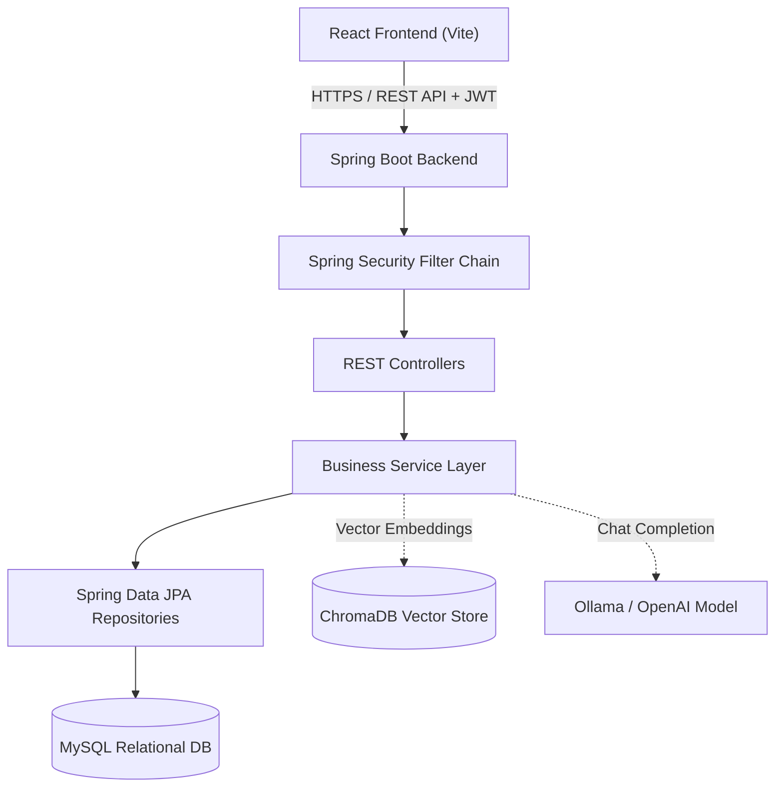
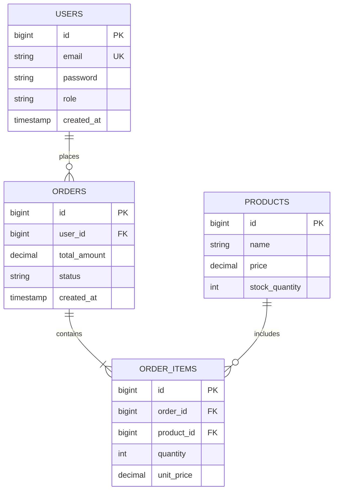

# [Project Name]

> **[One-sentence impactful summary of what the application does, who it serves, and its primary technical stack (e.g., Spring Boot 3.x, React, MySQL, Docker).]**

[](https://www.oracle.com/java/)
[](https://spring.io/projects/spring-boot)
[](https://react.dev/)
[](https://www.mysql.com/)
[](https://www.docker.com/)
[](LICENSE)

---

## 📌 Table of Contents
- [Overview & Problem Statement](#-overview--problem-statement)
- [Key Features](#-key-features)
- [Screenshots & UI Showcase](#-screenshots--ui-showcase)
- [System Architecture](#-system-architecture)
- [Technology Stack](#-technology-stack)
- [Prerequisites](#-prerequisites)
- [Local Installation & Setup](#-local-installation--setup)
- [Environment Variables Configuration](#-environment-variables-configuration)
- [Database Configuration & Schema](#-database-configuration--schema)
- [API Documentation](#-api-documentation)
- [Optional: AI / ML Integration](#-optional-ai--ml-integration)
- [Testing](#-testing)
- [Deployment Guide](#-deployment-guide)
- [Future Enhancements & Roadmap](#-future-enhancements--roadmap)
- [Author & Contact](#-author--contact)
- [License](#-license)

---

## 📖 Overview & Problem Statement

### The Problem
[Describe the business or user problem this application solves in 2-3 sentences. Explain the inefficiencies of existing solutions or the technical motivation behind creating this system.]

### The Solution
[Explain how this application solves that problem. Focus on architectural choices, real-time capabilities, algorithmic automation, or intelligent data processing.]

---

## ✨ Key Features

- **🔐 Stateless Security & Role-Based Access:** Secure authentication using Spring Security with JWT tokens, supporting multiple roles (e.g., `ROLE_USER`, `ROLE_ADMIN`).
- **⚡ High-Throughput RESTful APIs:** Well-structured API layer adhering to REST constraints, with comprehensive DTO validation and standardized error responses.
- **💾 Relational Persistence & Integrity:** Efficient queries with Spring Data JPA and Hibernate, configured with connection pooling (HikariCP) and indexing.
- **🎨 Responsive Modern Frontend:** Single-page application built with React, Vite, and Tailwind CSS offering real-time updates and intuitive UX.
- **🐳 Containerized Orchestration:** Multi-stage Docker build for reproducible local execution and streamlined production deployment.

---

## 📸 Screenshots & UI Showcase

| Dashboard View | Management Interface |
|:---:|:---:|
|  |  |
| *Real-time telemetry and metrics* | *Entity creation and management flow* |

*(Replace placeholder images with actual screenshots in `docs/screenshots/`)*

---

## 🏛️ System Architecture



---

## 🛠️ Technology Stack

| Layer | Technologies |
|---|---|
| **Backend** | Java 21, Spring Boot 3.x, Spring Web, Spring Security, Spring Data JPA |
| **Frontend** | React.js, Vite, Tailwind CSS, Axios, Lucide Icons |
| **Database** | MySQL 8.x, HikariCP, Hibernate ORM |
| **AI / ML (Optional)** | Spring AI, ChromaDB (Vector Store), Ollama / OpenAI API |
| **DevOps & Tools** | Docker, Docker Compose, Maven, Postman, Git |

---

## 📋 Prerequisites

Ensure you have the following installed on your machine:
- **Java Development Kit (JDK):** Version 17 or 21 (`java -version`)
- **Node.js & npm:** Node v18+ and npm v9+ (`node -v`, `npm -v`)
- **MySQL Server:** Version 8.0+ running on port `3306` (`mysql --version`)
- **Maven:** Version 3.8+ (or use the included `./mvnw` wrapper)
- **Docker & Docker Compose (Optional):** If running containerized (`docker --version`)

---

## ⚙️ Local Installation & Setup

### 1. Clone the Repository
```bash
git clone https://github.com/bhargavbhat18/[repository-name].git
cd [repository-name]
```

### 2. Database Initialization
Create a MySQL database instance:
```sql
CREATE DATABASE [database_name] CHARACTER SET utf8mb4 COLLATE utf8mb4_unicode_ci;
```

### 3. Backend Setup
Navigate to the backend directory and configure your environment variables:
```bash
cd backend
cp .env.example .env   # Or modify src/main/resources/application.properties
```

Build and run the Spring Boot application:
```bash
./mvnw clean install
./mvnw spring-boot:run
```
The backend will start at `http://localhost:8080`.

### 4. Frontend Setup
In a new terminal window:
```bash
cd frontend
npm install
npm run dev
```
The frontend will start at `http://localhost:5173`.

---

## 🔐 Environment Variables Configuration

Create a `.env` file in the backend root directory (or set system environment variables):

```properties
# Server Configuration
PORT=8080

# Database Configuration
SPRING_DATASOURCE_URL=jdbc:mysql://localhost:3306/[database_name]?useSSL=false&serverTimezone=UTC
SPRING_DATASOURCE_USERNAME=root
SPRING_DATASOURCE_PASSWORD=your_secure_password

# JWT Security
JWT_SECRET=your_base64_encoded_256_bit_secret_key_minimum_32_characters
JWT_EXPIRATION_MS=86400000

# CORS Allowed Origins
CORS_ALLOWED_ORIGINS=http://localhost:5173,https://your-domain.vercel.app

# Optional AI Integration (Ollama / ChromaDB)
SPRING_AI_OLLAMA_BASE_URL=http://localhost:11434
SPRING_AI_CHROMA_HOST=localhost
SPRING_AI_CHROMA_PORT=8000
```

---

## 🗄️ Database Configuration & Schema

### ER Diagram



---

## 📡 API Documentation

Interactive Swagger / OpenAPI UI documentation is available at:
```
http://localhost:8080/swagger-ui.html
```

### Core Endpoints Table

| HTTP Method | Endpoint | Description | Auth Required |
|---|---|---|:---:|
| `POST` | `/api/v1/auth/register` | Register a new user account | ❌ |
| `POST` | `/api/v1/auth/login` | Authenticate and obtain JWT token | ❌ |
| `GET` | `/api/v1/resources` | List all resources with pagination | ❌ |
| `GET` | `/api/v1/resources/{id}` | Get resource details by ID | ❌ |
| `POST` | `/api/v1/resources` | Create a new resource entity | ✅ (`USER`) |
| `PUT` | `/api/v1/resources/{id}` | Update existing resource entity | ✅ (`ADMIN`) |
| `DELETE` | `/api/v1/resources/{id}` | Delete resource entity | ✅ (`ADMIN`) |

---

## 🤖 Optional: AI / ML Integration

*(Include this section only if your repository contains AI/ML or RAG components)*

* **Model Architecture:** [e.g., Llama 3 via Ollama / OpenAI GPT-4o-mini / Custom Random Forest]
* **Dataset / Corpora:** [e.g., Domain-specific technical documentation, Kaggle dataset, synthetic sensor data]
* **Vector Store:** ChromaDB with [e.g., 384-dimensional `all-MiniLM-L6-v2` embeddings]
* **Evaluation Metrics:** [e.g., Accuracy, F1-Score, Retrieval Precision@K, Cosine Similarity Thresholds]
* **RAG Pipeline Workflow:**
  1. **Document Ingestion:** PDF/Text documents uploaded and split into 500-token chunks with 50-token overlap.
  2. **Embedding Generation:** Vector embeddings generated and indexed into ChromaDB collections.
  3. **Contextual Retrieval:** User queries mapped to vector similarity space; top-k relevant chunks injected into system prompt.
  4. **Grounded Synthesis:** Spring AI coordinates response generation strictly adhering to retrieved context.
* **Model Limitations:**
  * Context window limited to model token capacity.
  * Inference latency depends on underlying compute environment (local GPU/CPU).

---

## 🧪 Testing

Execute backend unit and integration tests:
```bash
cd backend
./mvnw test
```

Execute frontend linting and component tests:
```bash
cd frontend
npm run lint
npm run test
```

---

## 🚀 Deployment Guide

### Option A: Docker Compose (Recommended for Full Stack)
Run the entire containerized stack with a single command:
```bash
docker-compose up --build -d
```

### Option B: Cloud Production Deployment
- **Backend:** Deployed on **Render** using multi-stage `Dockerfile`.
- **Frontend:** Deployed on **Vercel** with automatic GitHub CI builds.
- **Database:** Managed MySQL instance (AWS RDS / PlanetScale / Aiven).

---

## 🗺️ Future Enhancements & Roadmap

- [ ] Add Redis caching layer for high-frequency database read operations.
- [ ] Integrate Stripe payment gateway integration with cryptographic webhook validation.
- [ ] Implement Kafka / RabbitMQ event-driven asynchronous notification processing.
- [ ] Configure Prometheus and Grafana metrics dashboard for JVM monitoring.

---

## 👤 Author & Contact

**Bhargav Bhat**  
*Java Full Stack Developer | Final-Year Information Science Engineering Student*

- 🌐 **Portfolio:** [bhargav-portfolio-v2.vercel.app](https://bhargav-portfolio-v2.vercel.app)
- 💼 **LinkedIn:** [linkedin.com/in/bhargavbhat18](https://www.linkedin.com/in/bhargavbhat18/)
- 🐙 **GitHub:** [@bhargavbhat18](https://github.com/bhargavbhat18)

---

## 📄 License

This project is licensed under the [MIT License](LICENSE) - see the LICENSE file for details.
