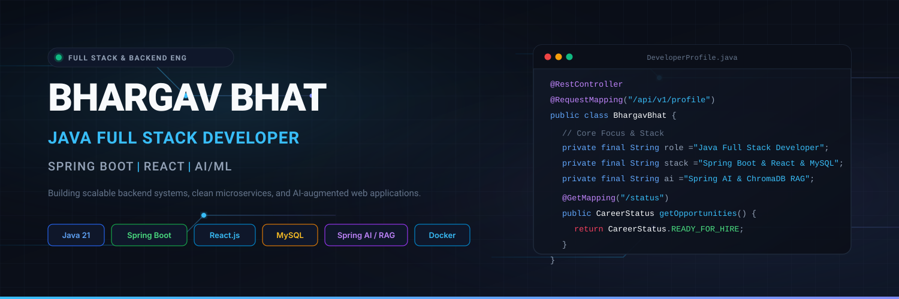

  <!-- Profile Banner -->
  

    

  <!-- Headline & Title -->
  <h1>Hi, I'm Bhargav Bhat 👋</h1>
  <h3>Java Full Stack Developer</h3>
  
<strong>Spring Boot &nbsp;|&nbsp; React &nbsp;|&nbsp; MySQL &nbsp;|&nbsp; REST APIs &nbsp;|&nbsp; AI/ML</strong>

  
<em>"Building practical applications with Java, Spring Boot, React, and AI."</em>

  <!-- Connect & Social Badges -->
  

    
    &nbsp;
    
    &nbsp;
    
  

---

### 👨‍💻 About Me

I am a final-year **Information Science and Engineering** undergraduate at **Gopalan College of Engineering and Management (GCEM), Bengaluru** (Graduation Batch of 2027). 

My primary engineering focus is **Java Backend and Full-Stack Development**, centered on architecting resilient services with **Java** and **Spring Boot**, coupled with dynamic, responsive user interfaces built in **React.js**. Through intensive hands-on academic work, competitive hackathons, and personal projects, I have developed practical competence in **RESTful API design**, **relational database modeling (MySQL)**, **stateless authentication (JWT)**, and **microservice containerization (Docker)**.

In addition to core full-stack software development, I actively engineer **AI-augmented applications**, exploring **Spring AI**, **Retrieval-Augmented Generation (RAG)** using vector stores (ChromaDB), and local LLM orchestration. My objective is to continuously advance my software architecture skills, producing clean, maintainable, production-ready code while preparing for software engineering internships and entry-level positions.

---

### 🎯 Current Focus

* **Java & Spring Boot Mastery:** Deepening proficiency in Spring Security 6, Spring Data JPA query optimization, transaction management, and WebSocket streaming.
* **Full-Stack Architecture:** Building decoupled architectures with Spring Boot REST backends, React/Vite frontends, and Tailwind CSS.
* **Applied AI Engineering:** Integrating local and cloud LLMs via Spring AI, exploring ChromaDB vector embeddings for document intelligence (RAG).
* **Engineering Standards:** Adopting Docker containerization, API documentation with OpenAPI/Swagger, unit testing, and automated GitHub Actions CI/CD workflows.

---

### 🛠️ Technical Skills

<table>
  <tr>
    <td width="24%"><strong>Programming Languages</strong></td>
    <td>
      
      
      
      
      
      
      
    </td>
  </tr>
  <tr>
    <td><strong>Backend Development</strong></td>
    <td>
      
      
      
      
      
      
    </td>
  </tr>
  <tr>
    <td><strong>Frontend Development</strong></td>
    <td>
      
      
      
    </td>
  </tr>
  <tr>
    <td><strong>Databases</strong></td>
    <td>
      
      
      
    </td>
  </tr>
  <tr>
    <td><strong>AI and Machine Learning</strong></td>
    <td>
      
      
      
      
      
      
    </td>
  </tr>
  <tr>
    <td><strong>Developer Tools &amp; Deployment</strong></td>
    <td>
      
      
      
      
      
      
      
    </td>
  </tr>
</table>

---

### 🚀 Featured Engineering Projects

#### 1. [E-Commerce Web Application](https://github.com/bhargavbhat18/E-Commerce-Web-Application)
> **Full-Stack E-Commerce Engine with Spring Boot, Spring AI Ollama, and React**

* **Problem Statement:** Modern e-commerce platforms demand transactional integrity, secure user authentication, interactive product exploration, and AI-assisted shopping capabilities.
* **Implementation & Architecture:**
  * Developed a modular **Spring Boot 3.2.5** backend exposing standard REST APIs documented via **Swagger / OpenAPI 2.5.0**.
  * Implemented stateless **Spring Security** with **JSON Web Tokens (JWT)** for role-based customer and administrator authentication.
  * Integrated **Spring AI Ollama Starter** to enable local LLM-assisted product insights and contextual recommendations.
  * Managed persistent relational data using **Spring Data JPA** and **MySQL** (`eazydeals_maven.sql`).
  * Built a high-performance, responsive storefront with **React** and **Vite**.
* **Tech Stack:** Java 17, Spring Boot 3, Spring AI, Spring Security, JWT, Spring Data JPA, MySQL, React, Vite, Swagger.
* **Engineering Value:** Demonstrates enterprise Java backend patterns, secure authentication filters, database migrations, and local AI model integration.

---

#### 2. [AI Document Analyzer](https://github.com/bhargavbhat18/AI-Documnet-Analyzer)
> **RAG Document Intelligence & Conversational System with Spring Boot, ChromaDB, and React**
> *(Note: Published as `AI-Documnet-Analyzer` on GitHub)*

* **Problem Statement:** Extracting accurate, hallucination-free insights from dense enterprise documents requires semantic document chunking, vector indexing, and grounded retrieval.
* **Implementation & Architecture:**
  * Implemented an end-to-end **Retrieval-Augmented Generation (RAG)** pipeline using **Spring Boot 3.3.4** and **Spring AI 1.0.0-M2**.
  * Configured **ChromaDB Vector Store** (`spring-ai-chroma-store`) for storing and querying high-dimensional document embeddings.
  * Built document ingestion services capable of parsing PDFs/text, chunking content, generating embeddings, and executing similarity searches.
  * Containerized the environment using multi-stage **Dockerfiles** and **Docker Compose** for reproducible local and cloud deployment.
  * Created an interactive **React & Vite** chat interface facilitating context-grounded Q&A.
* **Tech Stack:** Java 21, Spring Boot 3.3, Spring AI, ChromaDB, OpenAI / Ollama, Docker, Docker Compose, React, Vite.
* **Engineering Value:** Showcases modern AI engineering within the Java ecosystem, vector database indexing, RAG query pipelines, and containerization.

---

#### 3. [VitalGuard — Smart Health Monitoring Ecosystem](https://github.com/bhargavbhat18/Vital-Guard)
> **Connected Emergency Triage & Real-Time Patient Vital Monitoring Platform**

* **Problem Statement:** Emergency response teams face information gaps during patient transit, resulting in delayed hospital intake and suboptimal triage decisions.
* **Implementation & Architecture:**
  * Designed an integrated ecosystem featuring patient vital tracking (Heart Rate, SpO2, Temperature) with threshold alerts and emergency SOS dispatch.
  * Built a dedicated Java backend service (`vital-java`) leveraging **Spring Boot 4 / Java 21**, **Spring Data JPA**, **MySQL**, and **WebSockets** for real-time telemetry distribution.
  * Integrated an IoT synthetic biometric simulator mimicking wearable hardware data streams at scheduled intervals.
  * Provided coordinated interfaces for patients, hospital receiving staff, and attending physicians.
* **Tech Stack:** Java 21, Spring Boot, WebSockets, Spring Security, MySQL, Flutter/Dart Mobile App, React Dashboards.
* **Engineering Value:** Demonstrates multi-tier distributed system design, real-time bidirectional communication via WebSockets, and domain-driven healthcare workflows.

---

#### 4. [Spring AI Chatbot](https://github.com/bhargavbhat18/spring-ai-chatbot)
> **Context-Aware Conversational Assistant Built on Spring Boot & Spring AI**

* **Problem Statement:** Building robust conversational agents requires state management, prompt template isolation, and clean API boundaries for web clients.
* **Implementation & Architecture:**
  * Engineered a conversational backend utilizing **Spring AI** abstractions to manage chat memory and prompt completions.
  * Structured REST endpoints facilitating streaming and synchronous conversational exchanges.
  * Built a modern web interface in **React** with clean state management and responsive messaging views.
* **Tech Stack:** Java, Spring Boot, Spring AI, REST APIs, React, Vite.
* **Engineering Value:** Hands-on implementation of Spring AI core abstractions, message history preservation, and decoupled frontend-backend communication.

---

#### 5. [Ambulance Triage & Hospital Recommendation System](https://github.com/bhargavbhat18/ambulance-system-with-AI-assisted-triage)
> **AI-Assisted Emergency Dispatch & Transit Triage Coordination**

* **Problem Statement:** In critical trauma situations, transporting patients to the nearest hospital without knowing emergency bed availability and specialty care capability leads to fatal delays.
* **Implementation & Architecture:**
  * Developed an emergency coordination engine that aggregates in-transit biometric data and calculates patient triage priority scores.
  * Implemented an algorithmic hospital recommendation service matching patient condition severity to nearest suitable facility capacity.
  * Created real-time dispatch and hospital preparedness dashboards for coordinated handoffs prior to ambulance arrival.
* **Tech Stack:** Python, Machine Learning Triage Models, REST APIs, Web Portals.
* **Engineering Value:** Practical application of predictive decision-making algorithms to optimize mission-critical operational logistics.

---

#### 6. [Theater Seat Booking System](https://github.com/bhargavbhat18/Theater-Seat-Booking-System)
> **Relational Seat Allocation & Ticketing Engine with Spring Boot & MySQL**

* **Problem Statement:** High-concurrency ticket reservations require resilient relational schemas, relational mapping, and transactional boundaries to prevent double-booking.
* **Implementation & Architecture:**
  * Implemented core domain entities: Theaters, Screens, Movie Shows, Seat Layouts, and Bookings using **Hibernate / Spring Data JPA**.
  * Designed relational mappings with appropriate cascade types, fetch configurations, and JPQL queries for availability checking.
  * Exposed clean REST endpoints for checking showtimes, filtering available seats, and completing reservations.
* **Tech Stack:** Java 17, Spring Boot 3.1, Spring Data JPA, Hibernate, MySQL, Maven.
* **Engineering Value:** Solid demonstration of Object-Relational Mapping (ORM) design, database relationship integrity, and standard Spring service-repository layering.

---

### 📊 GitHub Activity & Statistics

  <table border="0">
    <tr>
      <td align="center" width="50%">
        
      </td>
      <td align="center" width="50%">
        
      </td>
    </tr>
    <tr>
      <td colspan="2" align="center">
        
      </td>
    </tr>
  </table>

  
<em>Note: Repository language percentages reflect overall codebase composition (including frontend dependencies, templates, and build scripts) across all public projects.</em>

---

### 🏆 Activities & Achievements

* **Smart India Hackathon (SIH) 2025:** Selected to participate in nationwide engineering hackathon solving real-world technological challenges.
* **Hackblox AI Open Source Hackathon 2026:** Built machine learning and computer vision solutions for open-source AI problem statements ([HackBlox-Hackathon-AI](https://github.com/bhargavbhat18/HackBlox-Hackathon-AI)).
* **Kaggle Machine Learning Competitions:** Active practitioner tackling predictive modeling, data cleaning, and feature engineering challenges.

---

### 🤝 Let's Connect & Collaborate

I am actively seeking **Java Full Stack Developer / Java Backend Developer** internship and entry-level opportunities where I can contribute to production-grade applications, design resilient APIs, and collaborate with forward-thinking engineering teams.

* 🌐 **Portfolio:** [bhargav-portfolio-v2.vercel.app](https://bhargav-portfolio-v2.vercel.app)
* 💼 **LinkedIn:** [linkedin.com/in/bhargavbhat18](https://www.linkedin.com/in/bhargavbhat18/)

   
  Designed with precision for software engineering recruiters & engineering peers • © 2026 Bhargav Bhat

